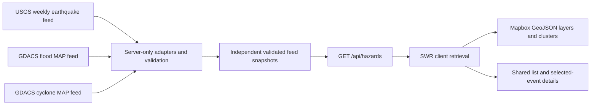

# Live Disaster Intelligence Map - implementation plan

Status: implemented locally with TDD and parallel work, verified on 15 November 2026.
Prepared on 15 November 2026 from the [repository audit, research, and interview](live-disaster-map-design.md).
This document records the implementation plan approved through the ticket breakdown and the subsequent implementation request.
See the [Disaster Explorer guide](disaster-explorer.md) for current setup, behavior, and verification guidance.
The acceptance evidence covers a local production build; hosted release verification is a separate step.

## Accepted product decisions

| Decision             | Accepted outcome                                                                                                            |
| -------------------- | --------------------------------------------------------------------------------------------------------------------------- |
| Audience and job     | Regional commanders identify reported hazards relevant to Malaysia and Southeast Asia for closer source-based investigation |
| Operational boundary | Read-only public intelligence; organizational incident creation and response coordination remain outside this milestone     |
| Providers            | USGS earthquakes plus GDACS floods and tropical cyclones                                                                    |
| Opening view         | Southeast Asia, with explicit Malaysia, Southeast Asia, and World camera presets                                            |
| Empty view           | Explain no matching reported locations; offer explicit navigation without silently expanding coverage                       |
| Geography            | Representative point markers with their meaning stated; no footprint or track layers                                        |
| Inspection           | One synchronized list/detail panel on desktop and one bottom sheet on mobile                                                |
| Main action          | Open the original provider report                                                                                           |
| Refresh              | Five-minute retrieval attempts while visible, pause while hidden, refresh on return or reconnection                         |
| Retrieval delay      | Indicate 15 minutes without a successful validated source retrieval, separately from source observation age                 |
| Resilience promise   | Keep loaded data during temporary failures where available; no guaranteed recovery after cache loss or reload               |
| Integration scope    | Two providers on existing services, with further sources behind explicit acceptance gates                                   |

The glossary defines [External Hazard Event, Managed Incident, and Regional Hazard Triage](../CONTEXT.md).
The feature does not promise exhaustive Malaysian warnings, verified danger at personnel locations, or continuous real-time observation.

## Approved technical defaults

- Add `/explorer` under the commander dashboard shell, labeled Disaster Explorer.
- Use direct `mapbox-gl`, SWR, and the existing Radix package for accessible sheet behavior.
  Preserve Bun, the lockfile, the configured Webpack build, and existing framework versions.
- Retrieve a bounded global dataset for the three selected hazard types, then filter the map and list locally.
  Panning and selecting a preset do not initiate provider queries.
- Use USGS M4.5+ earthquakes occurring in the last seven days and GDACS's source-selected current flood and cyclone listings.
  Display these different selection rules explicitly instead of exposing a misleading common ongoing or time-window filter.
- Cache successful validated snapshots per feed in Next.js for 300 seconds before revalidation is eligible.
  Use the existing cache configuration, with an isolated `unstable_cache` wrapper, rather than enabling Cache Components across the application.
- Keep the endpoint response uncached by the browser and service worker so source-health presentation uses the actual retained retrieval timestamp.
- Make no database changes and add no PostGIS, cron, queue, persistent archive, or new backend.
- Exclude free-text geographic search, universal severity ranking, source merging, additional providers, offline tiles, subscriptions, and operational mutations.

The submission deadline and implementation-hour budget remain unspecified.
Milestones therefore have dependency order and acceptance gates, not committed delivery dates.
Reserve the final quarter of whatever time is available for verification and demo preparation.

## Feature architecture

Two providers require three independently managed feeds: USGS earthquakes, GDACS floods, and GDACS cyclones.
Failures and retrieval timestamps belong to each feed rather than one blanket provider timestamp.
The public data path does not query organizational tables or the check-in outbox.

The page and existing layouts remain Server Components.
The interactive explorer, map lifecycle, filtering, selection, source-health display, and mobile sheet are client boundaries.
External fetch, validation, normalization, and caching stay in server-only modules.
Do not fetch providers during the production build merely to populate the page.

## Provider and temporal contracts

| Feed             | Fixed source                                                                                       | Selection and identity                                                                                    | Honest presentation                                                                              |
| ---------------- | -------------------------------------------------------------------------------------------------- | --------------------------------------------------------------------------------------------------------- | ------------------------------------------------------------------------------------------------ |
| USGS earthquakes | [M4.5+ weekly GeoJSON](https://earthquake.usgs.gov/earthquakes/feed/v1.0/summary/4.5_week.geojson) | `usgs:<feature.id>`; validate earthquake records, magnitude threshold, coordinates, and occurrence window | Epicenter, magnitude and magnitude type, depth in km, occurrence and source update times         |
| GDACS floods     | [MAP with eventtype=FL](https://www.gdacs.org/gdacsapi/api/Events/geteventlist/MAP?eventtype=FL)   | `gdacs:FL:<eventid>`; group representations before selecting a marker                                     | GDACS representative location, reported period, overall impact level, public report              |
| GDACS cyclones   | [MAP with eventtype=TC](https://www.gdacs.org/gdacsapi/api/Events/geteventlist/MAP?eventtype=TC)   | `gdacs:TC:<eventid>`; episode changes update one event                                                    | GDACS representative location, reported period, overall impact level, usable native measurements |

The seven-day USGS window is based on occurrence, not record modification.
GDACS current-list membership is preserved as a provider selection rule; it is not a declaration that danger is ongoing.
Events outside a viewport may still affect countries visible inside it, so the list says reported locations in view rather than hazards affecting the region.
Affected-country information may be shown in event details without changing the map's point-based membership rule.

GDACS marker selection requires both `geometry.type=Point` and `properties.Class=Point_Centroid`.
Exclude affected/global point representations, polygons, lines, and forecast cones from the marker set.
Collapse identical eligible representations for one event identity.
If eligible centroids conflict or a usable centroid is missing, omit that event's marker and expose an appropriate incomplete-data count instead of inventing a location.
Preserve episode and source identifiers as metadata.
The observed class convention is guarded by fixtures and a live contract check because the Swagger schema does not guarantee these response classes.

GDACS centroids have no verified per-point observation time or actual-versus-forecast flag.
Their observation timestamp remains null and details say observation time not supplied.
Preserve `fromdate` and `todate` as the GDACS reported period.
Use UTC interpretation for reported periods only where the source report establishes it, preserving the original value and interpretation.
Preserve `datemodified` as source record modification; offset-free values with undocumented timezone remain explicitly source time with timezone unspecified and are not converted into false UTC instants.
Do not use modification time as observation time.

USGS magnitude and GDACS overall impact level remain different measurements.
Do not rank mixed hazards by a fabricated common urgency score.
Suppress unusable GDACS generic measurements, including sampled flood values labeled Magnitude 0 with empty units.

## Normalized data contract

Use a shared Zod-validated public representation, with a narrow provider metadata union rather than arbitrary raw upstream payloads.

| Field group    | Required meaning                                                                                                              |
| -------------- | ----------------------------------------------------------------------------------------------------------------------------- |
| Identity       | Stable application ID, provider, feed ID, provider event ID, optional source episode ID                                       |
| Classification | Earthquake, flood, or tropical cyclone; source-native review or current-list status kept separately                           |
| Display        | Plain-text title, location label, optional affected countries, validated public report URL                                    |
| Geography      | WGS84 longitude/latitude and role: epicenter or provider representative location; positional accuracy unknown unless supplied |
| Measurements   | Native value, unit, scale/type, and label; null when unavailable or not meaningful                                            |
| Event times    | Occurrence or reported period, with source meaning and precision preserved                                                    |
| Source times   | Observation when genuinely supplied and record modification when supplied; retain raw values and timezone interpretation      |
| Retrieval      | UTC timestamp captured only after successful bounded retrieval, validation, and normalization                                 |
| Provenance     | Provider identifiers, selected representation class, permitted native status/impact fields, and source references             |

Each feed snapshot also carries its selection description, successful retrieval time, counts, and validation diagnostics.
The API response includes a schema version, response timestamp, feed snapshots or explicit unavailable entries, and overall availability.
The response timestamp is never substituted for a successful source retrieval.

There is no cross-provider merging in this release because hazard ownership is partitioned by provider.
Normalization is deterministic and repeatable, without an ingestion database or mutation IDs.
Cluster counts refer to displayed source events, not independently verified unique physical disasters.

## Next.js endpoint and caching

`GET /api/hazards` is the only new HTTP endpoint.
It uses fixed feed definitions and accepts no user-supplied upstream URL or cache-bypass operation.
All filters, camera changes, and selected-event details use the returned dataset.
No detail proxy, mutation endpoint, admin refresh route, or cron endpoint is needed.

Load the three feed snapshots concurrently with independent settlement.
Validate top-level response structure and each candidate record; omit invalid individual records with diagnostics, while treating a malformed feed envelope as a feed failure.
Treat a valid empty response as empty data rather than an outage; handle HTTP 204 explicitly where the provider contract permits it.
Give each upstream request an eight-second timeout and a two-MiB body limit, including streamed responses without Content-Length.
Do not perform immediate upstream retries inside the HTTP request.
Respect throttling responses and Retry-After where provided.

Store only successful validated snapshot results in the per-feed Next.js cache.
Throw retrieval/validation failures rather than caching an empty success in their place.
Use a versioned fixed cache key per feed and 300-second revalidation eligibility.
Keep request-local and best-effort process-local deduplication behind the cache module.
Shared cache behavior reduces duplicate requests but does not establish a distributed exactly-once refresh guarantee.
Cold-miss failure handling must include a short process-local cooldown to avoid immediate repeated upstream calls on one instance.

Next.js cache revalidation is demand-driven and can initially return the previous snapshot while refreshing it.
Thus five-minute browser checks do not promise provider observation freshness or changes appearing within five minutes.
Cache retention is an optimization, not a durable last-known-data guarantee.
Verify production-mode local revalidation and failure behavior before marking the cache integration gate complete.
If deployment is subsequently authorized, verify the same behavior on Vercel before making hosting-specific resilience claims.
If a cache miss has no retained snapshot, return that feed as unavailable.

Return HTTP 200 for at least one usable snapshot, including a legitimate empty snapshot, with explicit partial or delayed state where applicable.
Return HTTP 503 with a bounded structured error envelope when no feed snapshot is available, allowing client-held previous data to remain visible with retrieval failure.
Do not leak raw provider error bodies, internal stack traces, or environment values.
Set `Cache-Control: no-store` on the assembled endpoint response.

Cap the normalized response at 1,000 events and keep it below 512 KiB by stripping unused fields and rejecting oversized text.
If a limit must remove otherwise valid events, expose limited coverage and available/displayed counts; never truncate silently.
Use stable deterministic ordering for any limit and list rendering; do not imply a cross-hazard urgency rank.

The cache uses [Next.js's supported API for the current cache configuration](https://nextjs.org/docs/app/api-reference/functions/unstable_cache).
Do not opt the entire app into a new caching model for this feature.

## Frontend retrieval and map lifecycle

Use SWR for one stable `/api/hazards` key, five-minute checks, focus/reconnection refresh, request deduplication, and retained data during errors.
Its [revalidation behavior](https://swr.vercel.app/docs/revalidation) and [error handling](https://swr.vercel.app/docs/error-handling) fit this bounded read-only feed more directly than introducing a larger query architecture.
Use a 15-second client request timeout, browser-hidden/offline guards, and throttled manual retry.
For transport or all-feed failures, retry with increasing delay capped at five minutes while visible; avoid an unlimited rapid retry loop.
Reconcile partial responses per feed so an unavailable entry cannot silently erase a still-labeled client-held previous snapshot.
A valid empty successful snapshot does replace prior records for that feed.

Derive retrieval-delay state from each snapshot's retained successful retrieval timestamp and current time, even when requests stop completing.
Show the status of GDACS floods and cyclones separately if one fails.
Show source observation/record ages separately from retrieval health.
Connectivity indicators alone do not establish source health.

Create one Mapbox instance on mount, maintain a ref, and destroy it on unmount.
Use GeoJSON layers instead of a React DOM marker per event.
Filter the underlying feature collection before clustering so hidden types do not inflate cluster counts.
Stable IDs and a selected-event layer keep map and list selection synchronized.
Update the source data without remounting the map or resetting the camera.
Preset clicks and deliberate list navigation may move the camera; background refresh does not.
Cluster clicks expand the group, with list access to overlapping events that remain coincident at high zoom.
Use a debounced move-end calculation for the list's point-in-view membership, including longitude wraparound at the antimeridian.
No network cancellation machinery for viewport queries is needed because viewport queries do not exist in this release.

## Layout, interactions, and fallback states

The explorer page uses the existing commander navigation and theme system with route-specific map layout accommodation.
Keep the parent layout a Server Component and preserve other pages' padding and widths.
Expose navigation labels that remain usable in the mobile horizontal navigation.

The initial screen contains a compact title, a short real-external-data/demo-workspace explanation, three hazard-type controls, region presets, a source-health affordance, the map, and one compact list.
Use a quiet basemap, three distinct hazard icons and colors, a text legend, and adequate contrast.
Reserve source-defined impact levels and native measurements for list/detail badges.
Keep Mapbox and basemap attribution visible alongside USGS/GDACS data attribution.
No Mapbox Studio customization or geographic search service is required.

On desktop, selecting an event replaces the list in the same panel with details and a Back to results control.
On mobile, a compact list preview and selected-event details share one bottom sheet, with an accessible expand/close mechanism.
Use Radix focus handling, keyboard operation, escape behavior, and a reliable focus return target; dragging is optional rather than the only way to operate the sheet.
Keep map controls and attribution unobscured by the sheet.
List buttons provide a keyboard-accessible equivalent to canvas markers.

Details show type, title, location, geometry meaning, native measurement or impact label, reported/occurrence times, available source times, successful retrieval, provenance, and the original report link.
Selecting another marker updates the same details area.
If an event disappears on a successful refresh, keep the inspection context with a no-longer-listed notice until dismissed and remove its active marker.
If filters hide a selected event, state that it is outside the current results rather than silently selecting another one.

| State                                                        | Required behavior                                                               |
| ------------------------------------------------------------ | ------------------------------------------------------------------------------- |
| Loading                                                      | Map/list skeletons and source loading state, without fabricated events          |
| No points in view                                            | Honest empty list and explicit wider-region action                              |
| One feed unavailable                                         | Continue other feeds and explain the missing coverage                           |
| Retrieval older than 15 minutes                              | Visible delayed-refresh label and actual last successful retrieval              |
| Old source report, recent retrieval                          | Show both ages without calling the observation fresh                            |
| All feeds unavailable, no previous data                      | Unavailable state and retry; usable map controls if basemap loaded              |
| All-feed request failure with client data                    | Retain and label previous records with failure and retrieval age                |
| Offline                                                      | Keep current in-memory data labeled; no offline-map or durable-snapshot promise |
| Missing/invalid Mapbox token, tile failure, or WebGL failure | Keep list, filters, source status, details, and source links usable             |

## Security and deployment boundary

The endpoint exposes public hazard information only and requires no demo identity or organizational authorization.
It never reads organization, user, assignment, personnel, task, or check-in data.
All provider retrieval is server-side with fixed allowlisted destinations and bounded responses.
Render provider text as text and validate HTTPS report links against the intended provider hosts.
Keep arbitrary upstream HTML and URLs out of Mapbox popup HTML and DOM insertion.

Configure a dedicated least-privilege public Mapbox `pk` token as `NEXT_PUBLIC_MAPBOX_ACCESS_TOKEN`, restricted to the approved local and hosted origins.
This intentionally public browser token is distinct from a secret credential.
Never expose an `sk` token, database URL, or privileged provider credential.
No Mapbox variable name was present in the inspected example or local env configuration; actual basemap verification requires configuration during implementation.
Use the existing Mapbox account if available; account access and any spending require the user's authorized setup.

Preserve the service worker's current static-asset and generic-offline-shell policy.
Do not cache hazard API responses, operational pages, RSC, private records, or Mapbox tiles through the service worker.
Do not change the demo IndexedDB namespace or sync acknowledgement behavior.

This plan authorizes no deployment, production configuration, cloud mutation, commit, or push by itself.
If a later instruction authorizes deployment, follow [the operations runbook](operations.md) and report the exact revision and URL.
Any future database-backed hazard ingestion or operational linking requires a separately reviewed scope and schema/auth design.

## Implementation milestones

All tasks below are P0 unless explicitly marked otherwise.
Each milestone produces a demonstrable vertical increment and has a gate before expanding scope.

### Milestone 1 - live earthquake explorer

**T1: Define the hazard boundary and USGS adapter.**

- Files: `src/features/hazards/types.ts`, `validation.ts`, `providers/usgs.ts`, and `tests/hazards/usgs.test.ts` with bounded public fixtures.
- Dependencies: existing Zod and Bun test setup.
- Expected behavior: stable USGS identity, finite coordinates, native magnitude/depth, correct occurrence/update times, and explicit selection metadata.
- Acceptance: valid records normalize deterministically; non-earthquake, malformed, out-of-window, and unsafe-link records are handled explicitly; no fabricated substitute values.
- Testing: realistic fixture variants, null optional fields, coordinate bounds, timestamp semantics, and unchanged IDs across record revisions.

**T2: Deliver bounded cached public snapshots.**

- Files: `src/features/hazards/server/fetch-feed.ts`, `cache.ts`, `service.ts`, `src/app/api/hazards/route.ts`, and focused boundary tests.
- Dependencies: T1; existing Next.js cache configuration.
- Expected behavior: validated per-feed snapshot caching, time/body limits, unchanged retrieval time on cache hits, safe structured availability, and no organizational reads.
- Acceptance: real USGS data is available through the endpoint; valid emptiness is distinct from failure; cold failures cannot become cached empty successes.
- Testing: controlled upstream responses for timeout, invalid JSON/envelope, oversized body, throttling, cache hit, stale result, and no-snapshot failure.
  Verify cache semantics against a local production build as an integration gate rather than assuming a mocked cache proves runtime behavior.

**T3: Render a working Mapbox earthquake slice.**

- Files: `src/app/(dashboard)/explorer/page.tsx`, `src/features/hazards/explorer.tsx`, `use-hazards.ts`, `hazard-map.tsx`, shared map-source helpers, navigation, scoped layout styles, `.env.example`, `package.json`, and `bun.lock`.
- Dependencies: T2; install compatible stable Mapbox GL JS and SWR with Bun; configure the public Mapbox token.
- Expected behavior: real earthquake points, minimal synchronized list and selected-event details, preserved camera on retrieval, and source attribution.
- Acceptance: the commander can navigate to `/explorer`, inspect a genuine earthquake, and open its USGS report; missing-token and WebGL failure retain list access.
- Testing: browser verification of initial loading, map pan/zoom, selection, navigation teardown, public-token restrictions, and the list fallback.

Gate: real provider data reaches a usable map and source-linked details through the intended public boundary.

### Milestone 2 - complementary regional hazards

**T4: Integrate GDACS floods and cyclones.**

- Files: `src/features/hazards/providers/gdacs.ts`, feed definitions and service wiring, `tests/hazards/gdacs.test.ts`, and bounded sanitized centroid/representation fixtures.
- Dependencies: T2 and the confirmed MAP response contract.
- Expected behavior: one representative marker per event, retained episode metadata, native impact labels, honest reported periods and unknown observation times.
- Acceptance: the nine-feature flood fixture produces three events; the 103-feature cyclone sample produces two eligible event markers; conflicting centroids are diagnosed; polygons and misleading class names cannot become markers.
- Testing: duplicate representations, episode changes, missing/conflicting centroids, unsupported measurements, offset-free times, current-list status after reported end, and unsafe report links.

**T5: Expose partial coverage and freshness.**

- Files: feed snapshot assembly, client reconciliation, `source-status.tsx`, shared time presentation, and focused state-transition tests.
- Dependencies: T3 and T4.
- Expected behavior: three feed states, five-minute visible refresh, delayed retrieval after 15 minutes, retained client data, and source-specific selection explanations.
- Acceptance: failing GDACS cyclones does not hide floods or earthquakes; successful empty data replaces prior records; old source dates remain old after a new retrieval.
- Testing: injected per-feed failures, no-snapshot failures, valid empty responses, hidden/offline guards, stale age progression without completed requests, and recovery with unchanged camera/selection.

Gate: two real providers and three hazard types remain understandable under partial failure and lifecycle disagreement.

### Milestone 3 - complete commander interaction

**T6: Complete filtering, clustering, and synchronized inspection.**

- Files: explorer state/selectors, map-source helpers, `hazard-list.tsx`, `hazard-details.tsx`, and selected-event presentation.
- Dependencies: Milestone 2.
- Expected behavior: type filters update cluster counts and list together, presets move the camera, list selection highlights the same stable event, and refresh does not trigger automatic camera motion.
- Acceptance: hidden types are absent from cluster counts; coincident events remain accessible; no points in view is distinguished from no provider coverage; disappeared/filtered selections are explained.
- Testing: meaningful selector/GeoJSON tests and browser interaction with filters, clusters, world wrapping, refresh, and empty view.

**T7: Finish responsive layout and accessible sheet behavior.**

- Files: explorer route layout accommodation, `hazard-sheet.tsx`, existing Radix-backed UI integration as needed, source legend, and scoped styles.
- Dependencies: T6.
- Expected behavior: one desktop list/detail panel, one mobile sheet, touch-friendly controls, readable attribution, keyboard-equivalent list access, and consistent theme tokens.
- Acceptance: a phone-width viewport can explore, filter, select, inspect, return to results, and open a source; keyboard focus returns correctly; other commander pages retain their layout.
- Testing: desktop/mobile browser checks, keyboard navigation, focus/escape, reduced motion, light/dark contrast, and map resize after layout changes.

Gate: the complete read-only workflow is usable on desktop and mobile with the accepted scope.

### Milestone 4 - verify and demonstrate

**T8: Complete checks, documentation, and failure rehearsal.**

- Files: focused tests introduced above, `README.md`, and the feature plan/decision status.
- Dependencies: all previous gates; a configured token for actual basemap verification.
- Expected behavior: truthful setup instructions, known coverage/refresh limits, regression protection for the existing check-in behavior, and a repeatable two-minute demonstration.
- Acceptance: `bun run lint`, `bun run typecheck`, `bun run test`, `bun run build`, and `bun run format:check` pass, plus the browser and production-cache checks.
- Testing: live provider smoke checks separated from deterministic fixture tests; source timeout, all-feeds-down, malformed feed, token failure, offline, empty region, and unchanged local check-in behavior.
  Demonstrate at least one real earthquake and one real GDACS event without depending on an active event inside the opening viewport.
  If navigation to a wider region is necessary, do it explicitly and retain the source-selection explanation.

Gate: report actual verification, source state, limitations, and Git/deployment status before handoff.

## Demo and scope control

The two-minute demonstration opens on Southeast Asia, explains the source selection and retrieval times, inspects a regional flood or cyclone when available, opens its original report, and contrasts it with a recent earthquake's native measurements.
Then show a type filter, a cluster interaction, and mobile details.
Use an explicitly labeled controlled failure during verification to prove partial availability and truthful delayed data; do not manufacture live disaster records for the demonstration.

If time tightens, cut decorative transitions, elaborate marker artwork, and optional display refinements first.
Keep the two providers, representative-location labels, list access, usable mobile details, clustering, attribution, and failure handling.
Do not trade source correctness for a more crowded map.

Future integration gates require a concrete user outcome, verified live contract, geographic/temporal semantics, provenance and reuse review, and failure tests.
EONET, Malaysia advisories, FIRMS, NWS, ReliefWeb, InfoBanjir, and Copernicus remain outside this implementation plan.

## Approval boundary

The user agreed to product choices through Q11 and subsequently authorized implementation of the reviewed ticket breakdown with TDD and parallel work.
The implementation and local acceptance checks are complete.
Deployment, paid-service enrollment, commits, and pushes remain separate operations.
No new ADR has been created solely to record reversible library and first-milestone scope choices.
